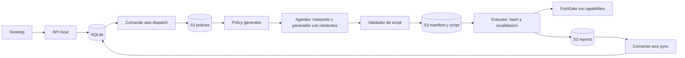

# Mapa de fuentes y limites

Decision para el trabajo futuro: el flujo de auditoria basado en documentos se
modifica en `audit-pipeline/`. Esta decision describe las fuentes; no demuestra
que ese arbol este desplegado actualmente en AWS.

| Fuente versionada | Responsabilidad | Verificacion |
| --- | --- | --- |
| `desktop/pps_desktop/` | GUI PySide6 y cliente HTTP | `desktop` |
| `audit-pipeline/api/pps_api/` | API local, SQLite, puente explicito S3 | `api` |
| `audit-pipeline/lambda/` | Assessor NIST y generador/ejecutor de politicas | `pipeline` |
| `audit-pipeline/terraform/` | Infraestructura de esas tres Lambdas y sus recursos | `iac` |
| `lambda/` + `terraform/` | Flujo NIST anterior independiente | `iac` sobre Terraform; sin suite Python propia |
| `fortigate-sandbox-2026-06-07/` | Infraestructura de la VM FortiGate | `iac` |
| `scripts/` + `.github/workflows/verify.yml` | Verificacion local y CI | `harness` |

`terraform/lambda.tf` empaqueta `lambda/` de la raiz; el mismo archivo dentro de
`audit-pipeline/terraform/` empaqueta `audit-pipeline/lambda/`. La coincidencia de
nombres no los convierte en fuentes intercambiables. No sincronizarlos ni borrar
uno sin una migracion explicita. Los tests del pipeline no cubren la copia raiz.

`P-Terraform-Forti-AWS/` esta ignorado y no forma parte del checkout reproducible.
Los ZIPs de layers se generan desde `audit-pipeline/scripts/build_layer.sh`.

## Flujo actual

Las flechas de dispatch/sync son comandos explicitos; iniciar la API o cargar un
documento por HTTP no los ejecuta. El flujo NIST programado coexiste con este flujo.

Los dos agentes de etapa se definen y cargan en `audit-pipeline/lambda/audit_agents.py`.
Ver [contratos, carga y limites](AGENTS_RUNTIME.md). La validacion y la ejecucion
siguen bajo controles deterministas; estos agentes no reemplazan esos controles.

## Invariantes

- La GUI no administra credenciales AWS, scripts generados ni conexiones FortiGate.
- La API valida documentos y correlaciona resultados; no inventa fases internas.
- El ejecutor vuelve a verificar integridad y AST antes de ejecutar un script.
- Presupuestos agotados conservan la advertencia de resultados parciales.
- El contrato cliente/servicio se documenta en `desktop/API_CONTRACT.md`.

## Pendientes de confirmacion operativa

No se inspeccionaron AWS, tfstate ni credenciales. Falta confirmar que stack esta
activo y como se migraria el flujo raiz. Quedan fuera de esta entrega el servicio
remoto multiusuario, deduplicacion S3, recuperacion de trabajos y evaluaciones
semanticas del modelo. Ver `audit-pipeline/api/README.md` para limitaciones actuales.
