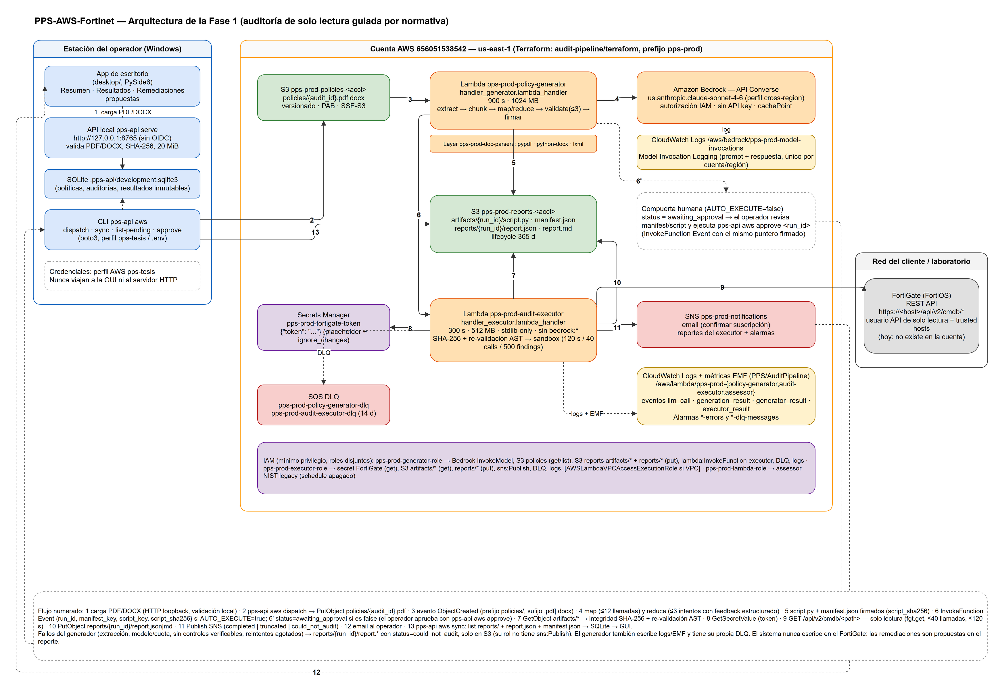
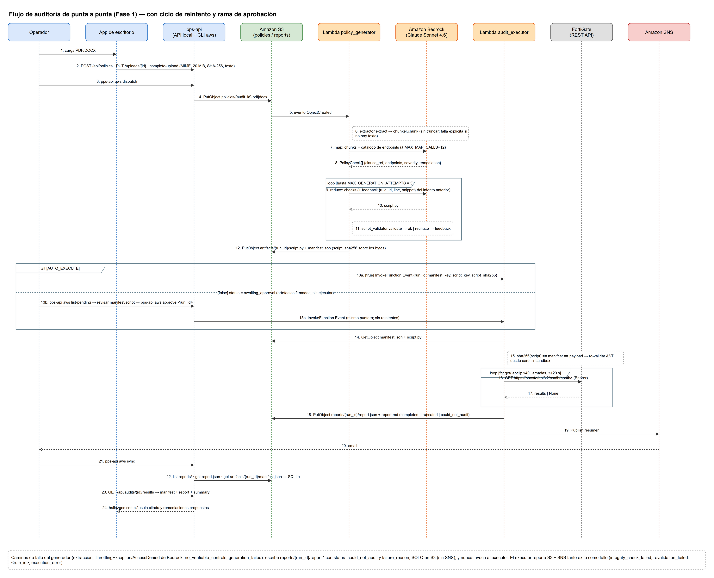
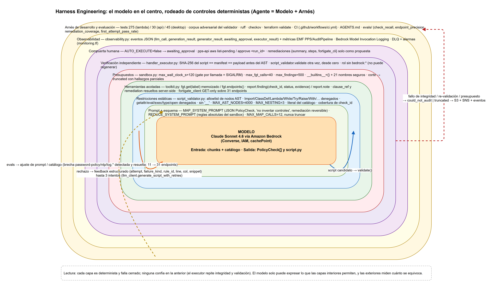
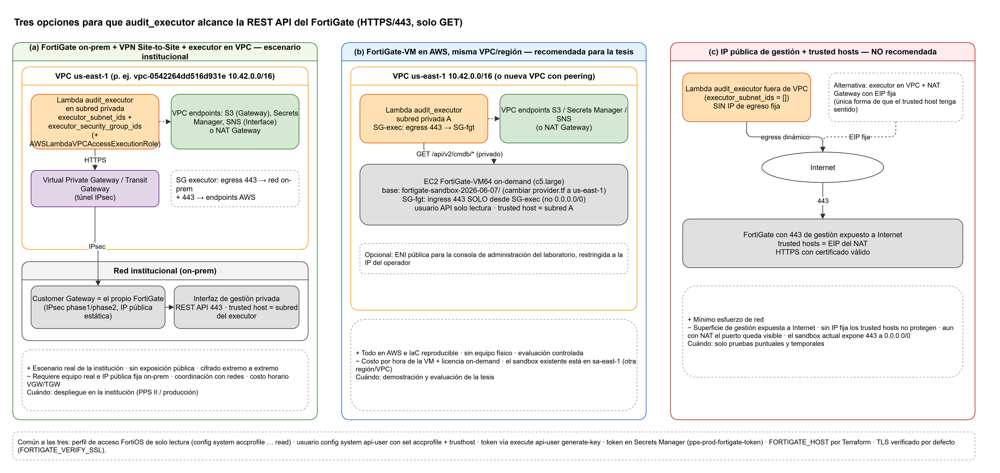
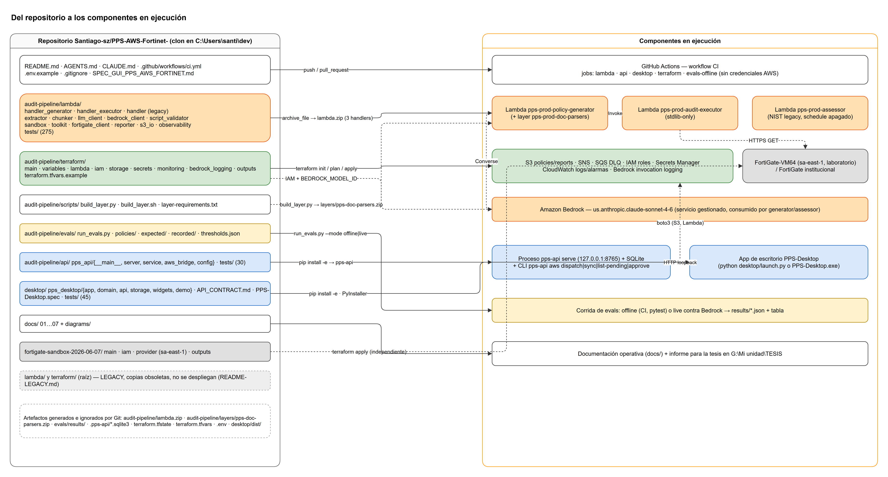
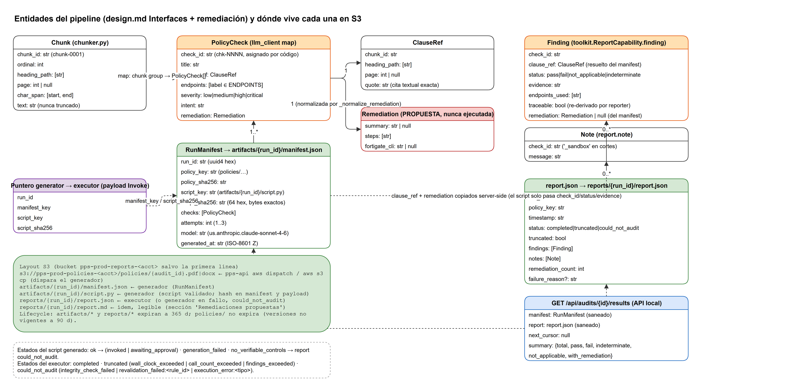

# Documentación operativa — PPS-AWS-Fortinet (Fase 1)

Índice de la documentación de operación, diseño y estado del proyecto. Los
documentos canónicos por tema siguen siendo `audit-pipeline/TESTING.md`,
`audit-pipeline/SECRETS.md`, `audit-pipeline/evals/README.md`,
`audit-pipeline/api/README.md` y `desktop/README.md`; esta carpeta los
integra en una vista de conjunto.

| Documento | Contenido |
|---|---|
| [01-arquitectura-fase1.md](01-arquitectura-fase1.md) | Arquitectura objetivo de la Fase 1: flujo de punta a punta, componentes AWS con nombres e IAM, dónde vive la IA, Lambda vs Step Functions, estados de un run, modelo de datos y layout S3. |
| [02-paso-a-paso-despliegue-y-prueba.md](02-paso-a-paso-despliegue-y-prueba.md) | Runbook numerado para Windows: prerrequisitos, clon fuera de Drive, venv y tests, perfil AWS, Bedrock (acceso y bloqueo de cuota), layer, Terraform, post-apply, prueba E2E, modo aprobación, evals, troubleshooting, publicación. |
| [03-harness-engineering.md](03-harness-engineering.md) | Qué es Harness Engineering, mapeo pilar → código, qué medir en la tesis, casos de estudio y limitaciones. |
| [04-estructura-del-repositorio.md](04-estructura-del-repositorio.md) | Árbol del repositorio con el propósito de cada carpeta y archivo, carpetas legacy y copias obsoletas. |
| [05-decisiones.md](05-decisiones.md) | Registro de decisiones (ADR): Bedrock, Lambda vs Step Functions, remediación como propuesta, fuera de Drive, executor sin modelo, bandera NIST, modelo Sonnet 4.6, prompt caching, cuota 0. |
| [06-conexion-fortigate.md](06-conexion-fortigate.md) | Preparar el FortiGate (perfil de solo lectura, usuario API, token, HTTPS), tres opciones de conectividad, verificación y catálogo de 31 endpoints de solo lectura (brecha password-policy/ntp/log.* resuelta). |
| [07-estado-y-pendientes.md](07-estado-y-pendientes.md) | Qué se hizo el 2026-11-04 por unidad de trabajo, números de verificación, hechos de la cuenta, pendientes y cómo retomar. |

Informe orientado a la tesis (fuera del repositorio):
`G:\Mi unidad\TESIS\FASE1-INFORME-PARA-TESIS.md`.

## Galería de diagramas

Fuentes editables en `diagrams/*.drawio` (draw.io desktop); exportaciones PNG
al lado de cada fuente.

### 01 — Arquitectura AWS

### 02 — Secuencia del flujo de auditoría

### 03 — Harness: capas de control alrededor del modelo

### 04 — Opciones de conectividad con el FortiGate

### 05 — Componentes y repositorio

### 06 — Modelo de datos y layout S3

